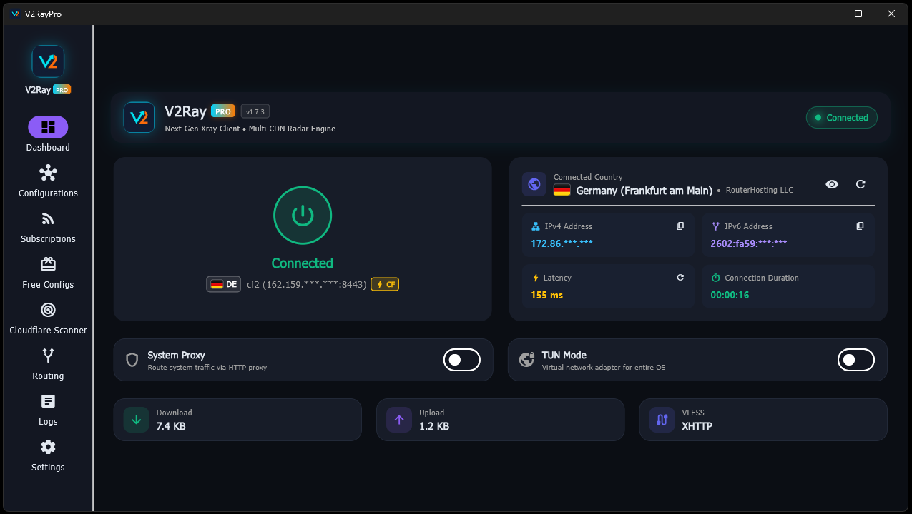
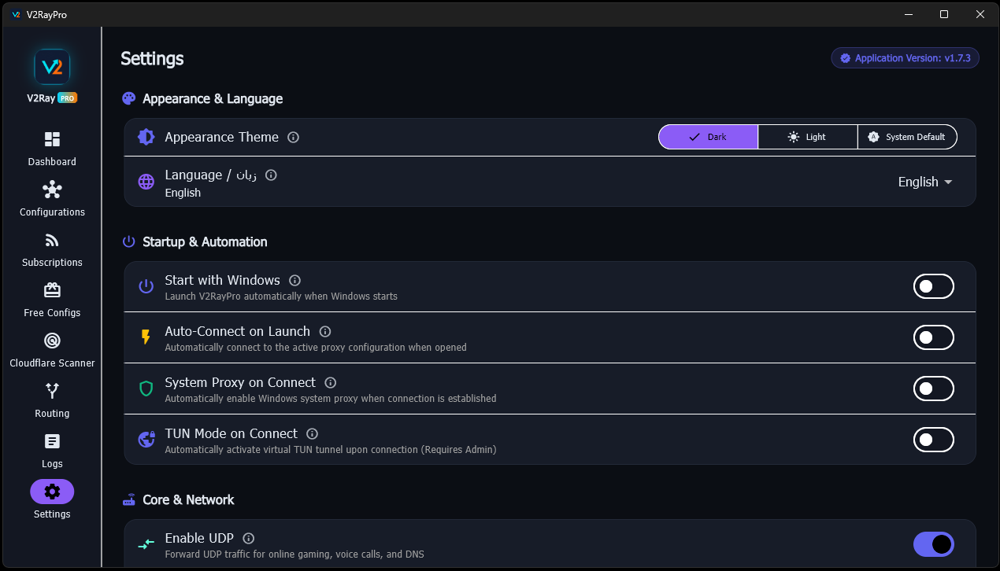
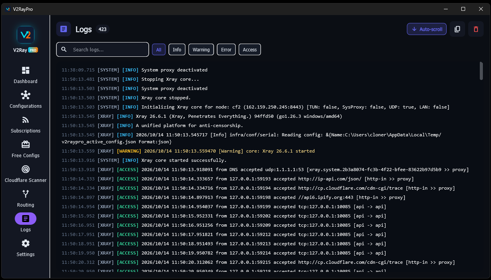

# نرم‌افزار V2RayPro (نسخه ویندوز)

  

  <strong>کلاینت پرسرعت و قدرتمند V2Ray / Xray و Sing-box برای ویندوز با اسکنر آی‌پی سالم کلودفلر</strong>

> 📱 **به دنبال نسخه اندروید هستید؟** به [مخزن مستقل V2RayPro Android](https://github.com/iamcloner/v2raypro-android) مراجعه کنید!

  <a href="README.md">English</a> • فارسی • <a href="README-ch.md">中文</a> • <a href="README-ru.md">Русский</a> • <a href="README-fr.md">Français</a> • <a href="README-sp.md">Español</a>

---

## 🚀 قابلیت‌ها

- **پشتیبانی دو هسته‌ای**: پشتیبانی بومی از هسته‌های Xray-core و Sing-box با امکان سوییچ سریع.
- **پروتکل‌ها**: پشتیبانی از VLESS، VMess، Trojan، Shadowsocks، Reality، WireGuard و Hysteria.
- **اسکنر اختصاصی کلودفلر**:
  - *حالت رادار*: رصد زنده و سوییچ خودکار روی بهترین پینگ بدون قطعی اینترنت.
  - *حالت تارگت*: تست دسته‌ای رنج‌های آی‌پی دلخواه با امکان تنظیم تا ۱۰۰ ورکر همزمان.
- **حالت‌های اتصال**: حالت TUN سراسری (Wintun) و پروکسی سیستم (HTTP/SOCKS5) همراه با روتینگ سایت‌های داخلی.
- **مدیریت ساب و کانفیگ**: خواندن لینک‌های بیس۶۴ و استاندارد، تست تاخیر واقعی HTTP و TCP، فیلتر کانفیگ تکراری.
- **رابط کاربری مدرن**: طراحی با فلاتر، تم تاریک و روشن، قرارگیری در سینی ویندوز (Tray) و اتصال خودکار.

---

## 📸 تصاویر برنامه

  

  
  

  
  

  
  

  
  

---

## 💻 روش نصب و اجرا

### ویندوز (نسخه ۶۴ بیتی)
۱. آخرین نسخه فشرده `v2raypro-windows-v1.7.3.zip` را از بخش [انتشارهای گیت‌هاب (Releases)](https://github.com/iamcloner/v2raypro/releases) دریافت کنید.  
۲. فایل زیپ را در پوشه دلخواه خود استخراج کنید.  
۳. فایل `v2raypro.exe` را اجرا کنید (برای استفاده از حالت TUN با دسترسی Administrator اجرا شود).

### نسخه اندروید
> 📱 **نکته**: **نسخه اندروید** هم‌اکنون در دست توسعه است و به زودی پس از آماده‌سازی در صفحه [انتشارهای گیت‌هاب](https://github.com/iamcloner/v2raypro/releases) قرار خواهد گرفت.

---

## 💖 حمایت مالی از پروژه (Donation)

اگر از برنامه راضی هستید و مایلید از توسعه مداوم آن حمایت کنید:

| نام ارز | شبکه | آدرس کیف پول |
| :--- | :--- | :--- |
| **BTC** | Bitcoin | `1JpSSvLjAj3wreRogBdjTMdEykW7YsX97b` |
| **ETH** | ERC20 | `0xE90973336d5c09B1183A8ddc4f27b1647Cbdc52A` |
| **TRX** | TRC20 | `TSuhDm1B7X4sz4xNjgd3Y6JGDXCgq8qv7b` |
| **BNB** | BEP20 | `0xE90973336d5c09B1183A8ddc4f27b1647Cbdc52A` |
| **TON / Gram** | TON | `EQDD0fo7jSaljn5q4dO02hhC1d3xc2Hr9N5AK2JqMCguZmnB` |
| **SOL** | Solana | `E5fNLHCaZhYTWWacyCnFXLEnkLT8pkiZUqbWEEnEhHQe` |
| **XMR** | Monero | `42o9i9DacHtbzndSx9eSPBFmAFrCeW9R2RWyv1ZJeNemKTAKDyHa8jRF8Ce8j7CVqJJBURGDNipKyC4ebigbPjVRUeMRHoK` |
| **XRP** | Ripple | `raxQ5Vg3awT1U7jx1Zv1znVcCrKVCJ8HNF` |
| **ETC** | ETC | `0xE90973336d5c09B1183A8ddc4f27b1647Cbdc52A` |
| **LTC** | Litecoin | `LSHokx4e2pbdmJaYpKqEkJUv3R4iE9t4zZ` |
| **ADA** | Cardano | `addr1qxlavq0fu3x2dzd685shgq46v6ysyu4w3w7g4pu6r6sjl95qwrclc2a2x6x4c5fgp80m27rupavltt62ezwcmx2z8ngsam72me` |

---

## 📄 مجوز

این پروژه تحت مجوز MIT منتشر شده است.

