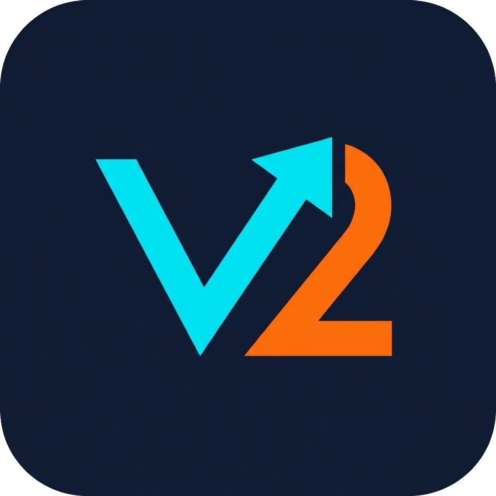
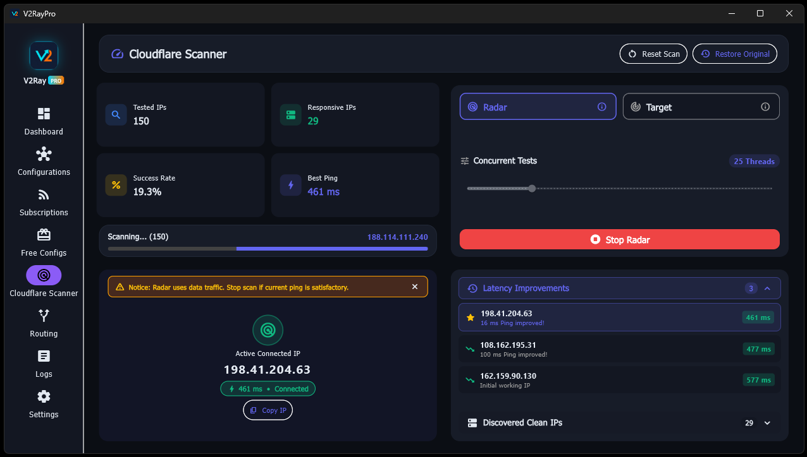
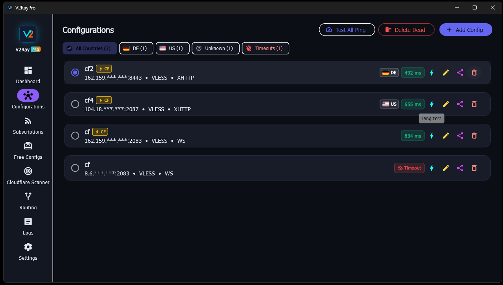
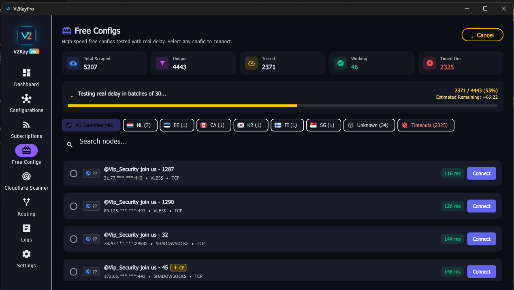
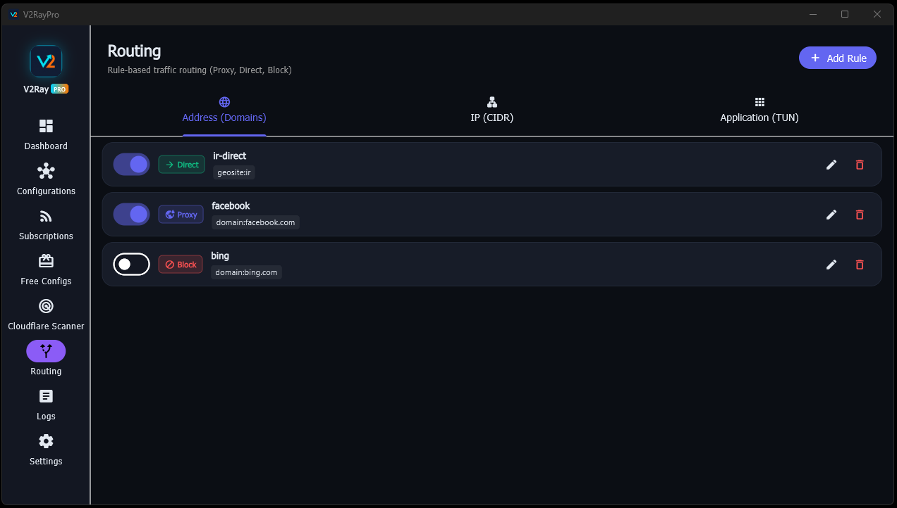
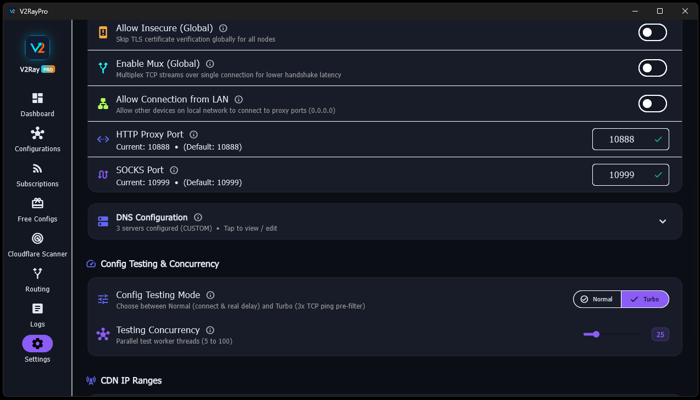

# V2RayPro (Documentation en français)

  

  <strong>Client graphique moderne et haute performance pour V2Ray / Xray et Sing-box avec scanner d'IP propres Cloudflare intégré</strong>

  <a href="#fonctionnalités">Fonctionnalités</a> •
  <a href="#installation">Installation</a> •
  <a href="#version-android">Version Android</a> •
  <a href="#captures-décran">Captures d'écran</a> •
  <a href="#dons-et-soutien-donation">Dons</a> •
  <a href="#licence">Licence</a>

---

### 🌐 Langues / Languages

[English](README.md) • [فارسی](README-fa.md) • [中文](README-ch.md) • [Русский](README-ru.md) • **Français** • [Español](README-sp.md)

---

## 🚀 Fonctionnalités

- **Moteur Multi-Cœur** : Prise en charge native des cœurs **Xray-core** et **sing-box** avec bascule instantanée.
- **Polyvalence des protocoles** : Compatibilité totale avec VLESS, VMess, Trojan, Shadowsocks, Reality, WireGuard et Hysteria.
- **Scanner d'IP propres Cloudflare intelligent** :
  - **Mode Radar** : Exploration automatique et en direct des plages IP Cloudflare, basculant en temps réel sur la meilleure IP sans couper la connexion.
  - **Mode Cible (Target)** : Test par lots des plages IP ciblées avec réglage des connexions simultanées (jusqu'à 100 workers).
  - Historique d'amélioration de la latence et avertissements compacts d'économie de bande passante.
- **Modes TUN Global et Proxy Système** :
  - Routage transparent de l'ensemble du trafic système grâce au pilote Wintun ultra-rapide.
  - Proxy système HTTP / SOCKS5 avec contournement intelligent des réseaux locaux et domaines régionaux.
- **Gestion avancée des abonnements et nœuds** :
  - Détection automatique des liens d'abonnement Base64 et formats standards.
  - Tests de latence : Ping TCP, délai HTTP réel et test de connectivité protocolaire.
  - Recherche, filtrage par pays/tags, tri et déduplication.
- **Expérience utilisateur moderne** :
  - Interface bureau soignée développée avec Flutter, modes sombre et clair.
  - Réduction dans la barre d'état système (System Tray), reconnexion automatique et lancement au démarrage.

---

## 📸 Captures d'écran

  

  

  
  

  
  

  
  

  

---

## 📱 Version Android

> **Remarque** : La version **Android** de V2RayPro est actuellement en cours de développement actif !  
> Elle apportera toute la puissance du routage et du scanner d'IP Cloudflare aux appareils mobiles. Restez à l'écoute des prochaines versions bêta sur la page [Releases](https://github.com/iamcloner/v2raypro/releases) !

---

## 💻 Installation

### Windows (x64)

1. Rendez-vous sur la page des versions [GitHub Releases](https://github.com/iamcloner/v2raypro/releases).
2. Téléchargez l'archive de la dernière version : `v2raypro-windows-v1.7.3.zip` (ou `v2raypro-v1.7.3-windows-x64.zip`).
3. Extrayez l'archive zip dans le dossier de votre choix (ex. : `C:\Program Files\V2RayPro` ou sur le Bureau).
4. Lancez `v2raypro.exe`.
   - *Pour le mode TUN* : Exécutez en tant qu'administrateur afin de permettre la création de la carte réseau virtuelle Wintun.

---

## 💖 Dons et soutien (Donation)

Si vous appréciez V2RayPro et souhaitez soutenir son développement continu, ses serveurs et ses mises à jour, vous pouvez faire un don en cryptomonnaie :

| Crypto | Réseau / Symbole | Adresse |
| :--- | :--- | :--- |
| **Bitcoin** | BTC | `1JpSSvLjAj3wreRogBdjTMdEykW7YsX97b` |
| **Ethereum** | ETH (ERC20) | `0xE90973336d5c09B1183A8ddc4f27b1647Cbdc52A` |
| **Tether / Tron** | TRX / TRC20 | `TSuhDm1B7X4sz4xNjgd3Y6JGDXCgq8qv7b` |
| **BNB** | BSC (BEP20) | `0xE90973336d5c09B1183A8ddc4f27b1647Cbdc52A` |
| **Telegram Open Network** | Gram / TON | `EQDD0fo7jSaljn5q4dO02hhC1d3xc2Hr9N5AK2JqMCguZmnB` |
| **Solana** | SOL | `E5fNLHCaZhYTWWacyCnFXLEnkLT8pkiZUqbWEEnEhHQe` |
| **Monero** | XMR | `42o9i9DacHtbzndSx9eSPBFmAFrCeW9R2RWyv1ZJeNemKTAKDyHa8jRF8Ce8j7CVqJJBURGDNipKyC4ebigbPjVRUeMRHoK` |
| **Ripple** | XRP | `raxQ5Vg3awT1U7jx1Zv1znVcCrKVCJ8HNF` |
| **Ethereum Classic** | ETC | `0xE90973336d5c09B1183A8ddc4f27b1647Cbdc52A` |
| **Litecoin** | LTC | `LSHokx4e2pbdmJaYpKqEkJUv3R4iE9t4zZ` |
| **Cardano** | ADA | `addr1qxlavq0fu3x2dzd685shgq46v6ysyu4w3w7g4pu6r6sjl95qwrclc2a2x6x4c5fgp80m27rupavltt62ezwcmx2z8ngsam72me` |

---

## 📄 Licence

Ce projet est distribué sous licence libre MIT.
